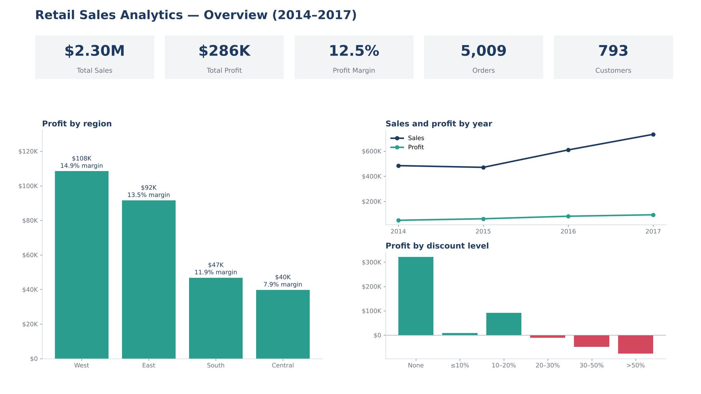
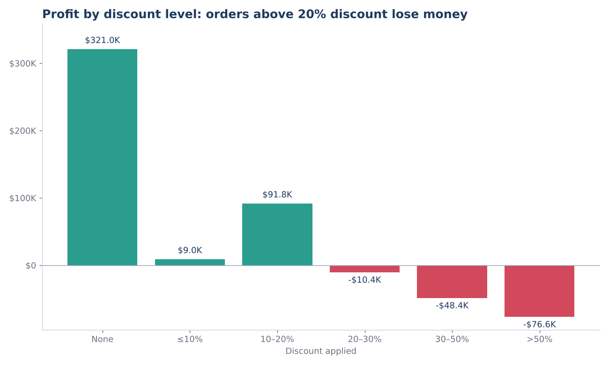
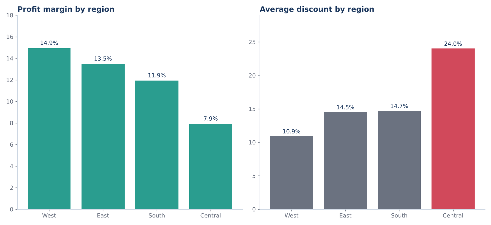
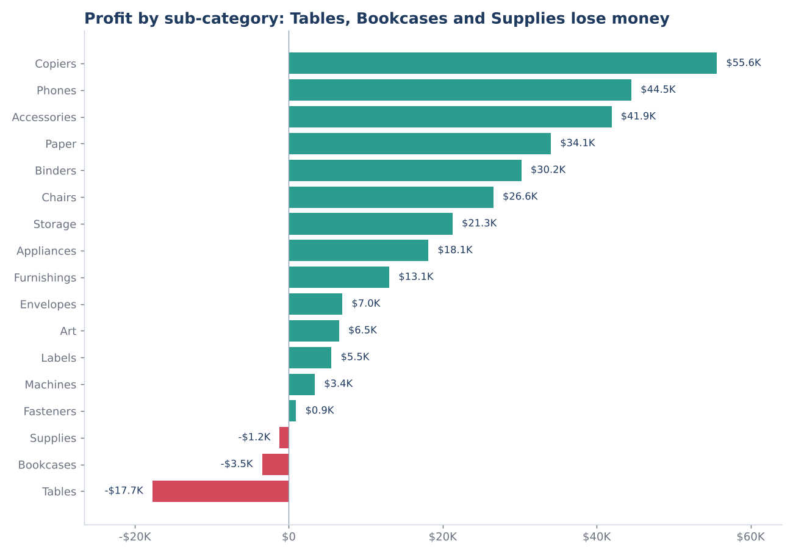
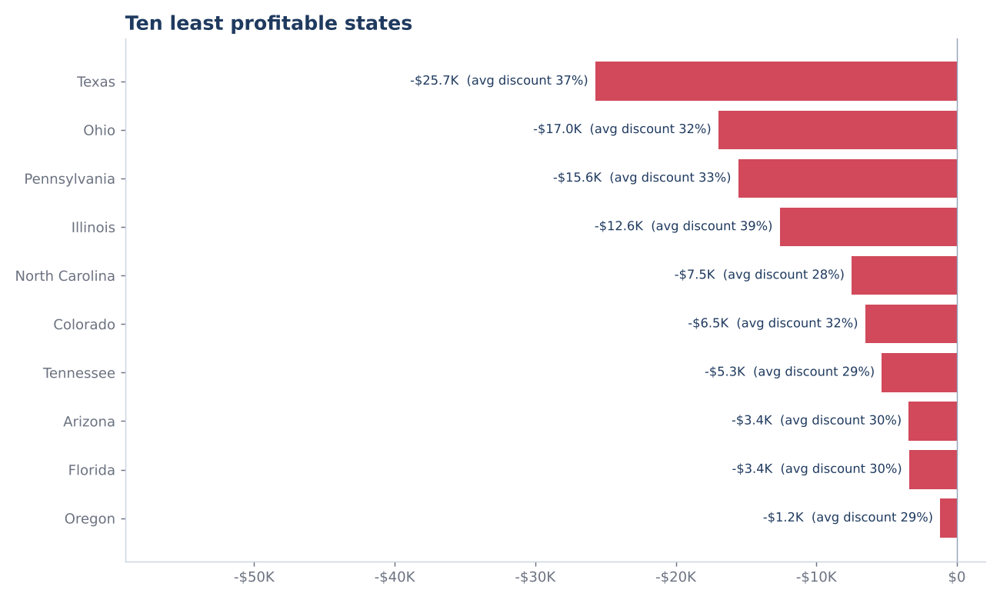
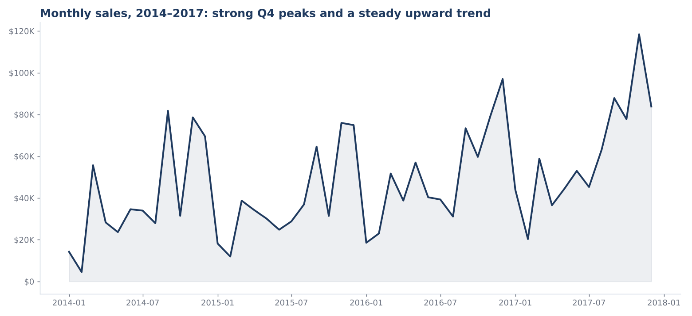

# Retail Sales Analytics

An end-to-end analysis of retail sales and profitability using **SQL, Excel, Power BI and Python**, built on the Sample Superstore dataset (9,994 order lines, 2014 to 2017).

**Headline result:** Orders discounted by more than 20% made up 14% of all order lines but lost **$135K**. Every order discounted by more than 50% lost money. All other orders earned **$422K** in profit, against $286K overall.



---

## Business Problem

A retailer has healthy sales but wants to know where it is actually making and losing money. This project answers:

1. Which regions and states generate the most sales and profit, and which lose money?
2. Which product categories and sub-categories are most and least profitable?
3. How do discounts affect profitability?
4. How have sales and profit changed over time?
5. Does shipping mode affect profit, and how concentrated is the customer base?

## Dataset

| | |
|---|---|
| **Source** | Sample Superstore dataset (Kaggle) |
| **Period** | January 2014 to December 2017 |
| **Rows** | 9,994 order lines (5,009 orders, 793 customers) |
| **Columns** | 21 |
| **Total sales** | $2,297,201 |
| **Total profit** | $286,397 (12.5% margin) |

Fields include orders, customers, region, state and city, category and sub-category, sales, quantity, discount and profit.

## Tools Used

| Tool | Used for |
|---|---|
| **SQL** | Business queries and aggregations (`sql/retail_sales_analysis.sql`, `sql query/`, `SQL query results/`) |
| **Excel** | PivotTables and summary analysis (`Excel Analysis.xlsx`) |
| **Power BI** | Interactive dashboard (`Data Visualization(Power bi).pbix`) |
| **Python / pandas** | Analysis, output tables and the charts in `images/` (`analysis.py`) |
| **Git and GitHub** | Version control and publishing |

---

## Key Findings

### 1. Discounts above 20% are the main profit leak

| Discount level | Order lines | Sales | Profit | Margin |
|---|---|---|---|---|
| None | 4,798 | $1,087,908 | $320,988 | 29.5% |
| Up to 10% | 94 | $54,369 | $9,029 | 16.6% |
| 10% to 20% | 3,709 | $792,153 | $91,756 | 11.6% |
| 20% to 30% | 227 | $103,227 | -$10,369 | -10.0% |
| 30% to 50% | 310 | $195,315 | -$48,448 | -24.8% |
| Over 50% | 856 | $64,229 | -$76,559 | -119.2% |

Discounts up to 20% stayed profitable. Between 20% and 50%, about 92% of order lines lost money, and every line above 50% did.



### 2. Regional performance

| Region | Sales | Profit | Margin | Average discount |
|---|---|---|---|---|
| West | $725,458 | $108,418 | 14.9% | 10.9% |
| East | $678,781 | $91,523 | 13.5% | 14.5% |
| South | $391,722 | $46,749 | 11.9% | 14.7% |
| Central | $501,240 | $39,706 | 7.9% | 24.0% |

- The **West** leads on both sales and profit, with the best margin.
- **Central** ranks third in sales but produces only 13.9% of total profit. It discounts more heavily than any other region (24.0% on average), and its Furniture category lost money (-1.8% margin).



### 3. Category and sub-category performance

| Category | Sales | Profit | Margin |
|---|---|---|---|
| Technology | $836,154 | $145,455 | 17.4% |
| Office Supplies | $719,047 | $122,491 | 17.0% |
| Furniture | $741,999 | $18,451 | 2.5% |

Technology and Office Supplies generate about 94% of total profit. **Furniture** brings in 32% of sales but only 6.4% of profit.

Three sub-categories lose money:

| Sub-category | Sales | Profit | Margin | Average discount |
|---|---|---|---|---|
| Tables | $206,966 | -$17,725 | -8.6% | 26.1% |
| Bookcases | $114,880 | -$3,473 | -3.0% | 21.1% |
| Supplies | $46,674 | -$1,189 | -2.5% | 7.7% |

- **Tables and Bookcases** explain Furniture's weak profit. About $11K of the Tables loss comes from the East region, where the average Tables discount is 37.4%.
- **Machines** sell $189K but earn only $3.4K (1.8% margin), with an average discount of 30.6%.
- **Copiers** are the most profitable sub-category: $55.6K profit (about 19% of the total) at a 37.2% margin, on only 6.5% of sales.
- Supplies lose money despite a low average discount, so discounting does not explain that one.



### 4. Loss-making states

The ten least profitable states all discount heavily, averaging **28% to 39%** compared with **15.6%** across the whole dataset. Texas (-$25.7K), Ohio (-$17.0K), Pennsylvania (-$15.6K) and Illinois (-$12.6K) lose the most.



### 5. Growth and seasonality

- Sales grew from **$484K in 2014 to $733K in 2017**. 2015 dipped 3%, then sales rose 30% in 2016 and 20% in 2017.
- Profit grew every year, from **$49.5K to $93.4K**, as the margin improved from 10% in 2014 to about 13% from 2015 onward.
- Across all four years combined, **November ($352K), December ($325K) and September ($308K)** are the strongest months. February is the weakest ($60K).



### 6. Shipping, customers and segments

- **Shipping mode does not drive profit.** Margins are similar across modes (12.1% to 13.9%). Standard Class handles about 60% of order lines and averages 5.0 days, against 2.2 days for First Class and 3.2 for Second Class.
- **The customer base is not concentrated.** The top 10 customers account for only 6.7% of sales. However, **155 of 793 customers (20%) are unprofitable**, with combined losses of about $71K. The top customer by sales lost money.
- **Segments:** Consumer (11.5% margin), Corporate (13.0%) and Home Office (14.0%) are all profitable. Consumer is the largest by sales.

---

## Recommendations

1. **Cap discounts at 20%.** Order lines above that level were almost always loss-making, and they cost $135K in total.
2. **Review discount approval in Central and in the loss-making states** (Texas, Ohio, Pennsylvania, Illinois), where average discounts are far above the 15.6% norm.
3. **Review Tables pricing**, especially in the East where the average discount is 37%, and reprice or review the costs of Machines and Supplies.
4. **Focus growth on high-margin lines** such as Copiers, Paper and Accessories.
5. **Plan stock and promotions around the September to December peak**, and avoid deep discounting in those months.
6. **Review unprofitable customers** (20% of the customer base) to see whether discounts or product mix are the cause.

---

## Power BI Dashboard

The Power BI report is in `Data Visualization(Power bi).pbix`.

<!-- Replace the lines below with screenshots of your own Power BI report, saved in the images/ folder -->
<!--  -->
<!--  -->

## Project Structure

```
Retail-Sales-Analytics/
├── README.md
├── superstore.csv                     # Raw dataset
├── analysis.py                        # Python analysis
├── region_analysis.csv                # Sales and profit by region
├── category_analysis.csv              # Sales and profit by category
├── subcategory_analysis.csv           # Sales and profit by sub-category
├── Excel Analysis.xlsx                # Excel PivotTables and summary
├── Data Visualization(Power bi).pbix  # Power BI dashboard
├── sql/
│   └── retail_sales_analysis.sql      # 10 business queries
├── sql query/                         # SQL queries
├── SQL query results/                 # Query outputs
└── images/                            # Charts used in this README
```

## Author

**Elvis Elosindu**
Data Analytics Portfolio Project

- Email: [lordritchie7@gmail.com](mailto:lordritchie7@gmail.com)
- GitHub: [lordritchie7-coder](https://github.com/lordritchie7-coder)
<!-- Add your LinkedIn link here -->

---

*Dataset source: Sample Superstore dataset, available through Kaggle. Charts in `images/` were generated with Python (matplotlib) from the same data.*
